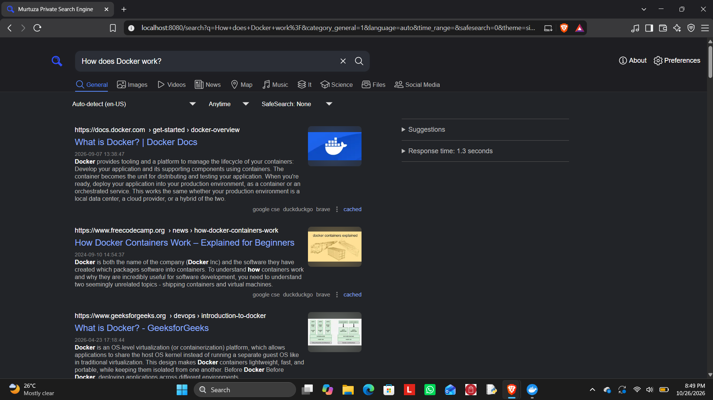

# Murtuza Private Search Engine 🔎

A personal, privacy-focused metasearch engine built using **SearXNG and Docker**, running locally on Windows.

## 📸 Project Screenshot

## 📌 About the Project

Murtuza Private Search Engine is a self-hosted search engine powered by SearXNG. It provides a single interface for searching the web using multiple search engines.

This project explores self-hosting, containerization, web search, and online privacy.

## ✨ Features

- Custom search engine name and branding
- Web search through a single interface
- Multiple search categories, including images, videos, news, and maps
- Dark-themed search interface
- Local deployment for personal use
- Privacy-focused approach to web searching

*Available features depend on the configuration and enabled search engines.*

## 🛠️ Technologies Used

- **SearXNG** — Metasearch engine
- **Docker** — Containerization
- **Windows 11** — Host operating system
- **WSL 2** — Linux environment for Docker Desktop, if used in this setup
- **YAML** — Configuration

## 🎯 Project Objectives

- Learn to deploy a self-hosted application.
- Understand Docker containers and their role in deployment.
- Customize application configuration and branding.
- Explore privacy-conscious alternatives to conventional search engines.
- Develop practical troubleshooting and documentation skills.

## 🔒 Privacy Considerations

Self-hosting provides greater control over the search application, but it does not guarantee complete anonymity.

Search engines used by the instance may still receive search queries. Privacy also depends on the configuration, logging, network setup, and enabled services.

## 📚 Learning Outcomes

- Self-hosted applications
- Docker-based deployment
- Application configuration
- Basic system troubleshooting
- Technical documentation

## 🚀 Future Improvements

- Improve the user interface and branding.
- Review and optimize search engine settings.
- Document the Docker deployment architecture.
- Explore secure remote access and HTTPS deployment.
- Add setup and troubleshooting instructions.

## 👨‍💻 Author

**Mirza Murtuza Hussain**

IT Engineering Student | Aspiring Software Developer
